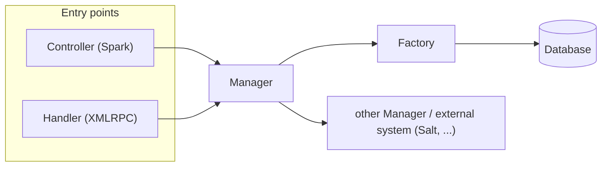

- Feature Name: java_components_and_boundaries
- Start Date: 2026-10-30


# Summary
[summary]: #summary

This RFC clarifies what each kind of Java component in Uyuni is responsible for, and where the boundaries between them are.

The rules apply to **new code and code we touch anyway**, so that contributors and reviewers have a shared reference.

## Non-goals

To keep the discussion focused, this RFC explicitly does **not**:

- move, rename or reorganize any package (`com.redhat.rhn`, `com.suse.*` or anything else)
- require refactoring any existing code
- set a migration plan or timeline
- define modules, containers or build changes

Where code lives is a separate discussion. The rules below apply regardless of the package a class is in.


# Motivation
[motivation]: #motivation

The same responsibility is implemented today in different places: a business rule can live in an XMLRPC handler, a Spark controller, a Manager or a Factory. There is no agreed answer to "where does this go?", so every contributor and every reviewer answers it differently.

Some consequences:

- business logic is duplicated between XMLRPC handlers and Web UI controllers, and the two drift apart
- data access and business rules are mixed in the same method, so neither can be tested alone
- there are no rules on which component may call which, so calls can go in every direction: Controllers query the database, Factories calling Managers, Web UI Controllers call XMLRPC Handlers. Then, a change in one place can break code that should never have depended on it.
- code review spends time on the same structural debates in every PR

## Expected outcome

- A contributor can tell where a piece of logic belongs without asking.
- A reviewer can point to a rule instead of a personal preference.
- The XMLRPC API and the Web UI share the same business logic instead of copying it.


# Detailed design
[design]: #detailed-design

## The components

| Component | One-line responsibility |
|-----------|-------------------------|
| **Controller / Handler** | Receives an external request, calls a Manager, translates the result back |
| **Manager** | Implements business rules, validation and orchestration |
| **Factory** | Reads and writes persistent data |
| **Entity** | Maps one database row; holds persistent state and relationships |
| **DTO** | Carries data across a boundary; holds no behavior |
| **Mapper** | Converts data from one representation to another |

### Controller / Handler

*Based on:* the Controllers of the "Interface Adapters" layer in [The Clean Architecture](https://blog.cleancoder.com/uncle-bob/2012/08/13/the-clean-architecture.html) (Martin): *"a set of adapters that convert data from the format most convenient for the use cases and entities, to the format most convenient for some external agency such as the Database or the Web"*.

Anything that starts work from outside the business logic:

- Web UI controllers (Spark)
- XMLRPC handlers (`*Handler`)
- Taskomatic jobs, Salt event / reactor handlers and similar follow the same rules

**Responsibilities**
- extract and parse input (request params, XMLRPC arguments, job parameters, event payload)
- check input *shape*: required parameters present, correct types, parseable formats
- resolve the caller (logged-in user, org) and pass it to the Manager
- delegate the work to one or more Managers
- translate the result into the protocol's format (JSON, XMLRPC struct, job result)
- translate Manager exceptions into protocol errors (HTTP status, XMLRPC fault)

**Must not**
- contain business logic. For example, checking whether a channel has child channels before deleting it. This belongs in the Manager, not in the Controller or Handler.
- access or interact with the database directly: no Factory calls, Hibernate sessions, or queries.
- modify Entities.
- call a Controller or Handler belonging to a different protocol. For example, a Web UI Controller must not call an XMLRPC Handler. Shared logic belongs in a Manager.


### Manager

Managers are where business logic lives. Each one groups the operations of one functional area, and entry points should rely on them.

This role matches what Fowler calls a [Service Layer](https://martinfowler.com/eaaCatalog/serviceLayer.html) (*Patterns of Enterprise Application Architecture*, 2002): a layer that *"defines an application's boundary"* and *"encapsulates the application's business logic"*, so that every kind of client uses the same operations.

**Responsibilities**
- expose complete business operations. If a caller would need the result of one Manager call to make the next, or would have to make calls in a specific order, that sequence belongs inside one Manager method.
- enforce business rules and *business* validation (permissions, state, invariants)
- orchestrate Factories, other Managers and external systems (Salt, Cobbler, ...)
- throw exceptions that describe what went wrong (for example, `ChannelHasChildrenException`). Each Controller or Handler decides how to report them to its caller: HTTP error, XMLRPC fault, job failure.

**Must not**
- know which protocol called it: no `Request`/`Response` from Spark, no XMLRPC types, no HTTP status codes, no JSON
- build queries or call Hibernate sessions directly; that goes through a Factory

A Manager **may** call another Manager.

### Factory

*Based on:* [Repository](https://martinfowler.com/eaaCatalog/repository.html) (Fowler, PoEAA). In Uyuni this role is played by the Factories (not to be confused with the GoF Factory pattern).

**Responsibilities**
- CRUD and queries for one Entity or a closely related group of Entities
- hide the persistence technology (HQL, named queries, native SQL, `datasource` mode queries)

**Must not**
- contain business rules. For example, deciding whether a user may see a channel based on their org admin role belongs in the Manager, not in the lookup query.
- call Managers
- return DTOs tied to one kind of caller (exclusively), such as a Web UI screen or the XMLRPC API. Returning DTOs any caller can use is fine.

### Entity

*Based on:* the [Jakarta Persistence entity](https://jakarta.ee/learn/docs/jakartaee-tutorial/current/persist/persistence-intro/persistence-intro.html). This is not the DDD Entity, which also carries domain behavior.

**Responsibilities**
- map a database row: fields, relationships, Hibernate annotations
- keep its own state consistent: simple invariants on its own fields (e.g. `setName` rejects null when the column is `NOT NULL`)

**Must not**
- call Managers, Factories or any static lookup
- open sessions, run queries, or trigger side effects (Salt calls, events, emails)
- know about other users of the data (UI, API)

### DTO

*Based on:* [Data Transfer Object](https://martinfowler.com/eaaCatalog/dataTransferObject.html) (Fowler, PoEAA). Fowler's DTO exists to reduce remote calls; we use the broader Java meaning of a data carrier across any boundary (see [LocalDTO](https://martinfowler.com/bliki/LocalDTO.html)).

**Responsibilities**
- carry data across a boundary: Manager ↔ Controller/Handler, Factory projection, external API payload

**Must not**
- contain behavior beyond trivial accessors, `equals`/`hashCode`/`toString`, or derived read-only values computed from its own fields
- call any other component, or any static method that does I/O or lookups
- be a Hibernate-managed Entity

### Mapper

*Based on:* [Mapper](https://martinfowler.com/eaaCatalog/mapper.html) (Fowler, PoEAA). Not to be confused with Fowler's *Data Mapper* (object ↔ database), which is Hibernate's job.

**Responsibilities**
- convert one representation into another, as a pure function. For example: Entity to DTO, DTO to JSON or XMLRPC struct, a Salt or external API payload to a DTO.

**Must not**
- query, persist, or call Managers
- make business decisions. If the conversion depends on a rule, the Manager decides and passes the result in


## Dependency rules

The arrows show who may call whom. This is the classic layering of [Service Layer](https://martinfowler.com/eaaCatalog/serviceLayer.html) (Fowler, PoEAA): presentation calls the service layer, which calls the data source layer, never the other way round.



## Examples

Some of the following examples will also be in [this PR](https://github.com/uyuni-project/uyuni/pull/12870)

### Merging errata between channels

**Before:** the Handler:
- acquires the source and target channels;
- checks user permission to the channels;
- queries the Errata Factory for the source errata;
- delegates the merge operation to a Manager;
- converts the result into the expected XML-RPC response format.

The Handler should be oblivious to the business rules. Its only responsibilities should be to delegate the operation and translate the result and any exceptions into the expected XML-RPC response format.

```java
// ChannelSoftwareHandler (XMLRPC)
public Object[] mergeErrata(User loggedInUser, String mergeFromLabel,
        String mergeToLabel, String startDate, String endDate) {

    Channel mergeFrom = lookupChannelByLabel(loggedInUser, mergeFromLabel);
    Channel mergeTo = lookupChannelByLabel(loggedInUser, mergeToLabel);

    if (!UserManager.verifyChannelAdmin(loggedInUser, mergeTo)) {
        throw new PermissionCheckFailureException();
    }

    List<Errata> fromErrata = ErrataFactory.lookupByChannelBetweenDates(
            loggedInUser.getOrg(), mergeFrom, startDate, endDate);

    Set<Errata> mergedErrata = ErrataManager.mergeErrataToChannel(loggedInUser,
            new HashSet<>(fromErrata), mergeTo, mergeFrom);

    return mergedErrata.toArray();
}
```

**After:**

```java
// ChannelSoftwareHandler (XMLRPC)
public Object[] mergeErrata(User loggedInUser, String mergeFromLabel,
        String mergeToLabel, String startDate, String endDate) {
    try {
        return ErrataManager.mergeErrata(loggedInUser, mergeFromLabel, mergeToLabel,
                startDate, endDate).toArray();
    }
    catch (PermissionException e) {
        throw new PermissionCheckFailureException();
    }
    catch (LookupException e) {
        throw new NoSuchChannelException();
    }
}

// ErrataManager
public static Set<Errata> mergeErrata(User user, String mergeFromLabel,
        String mergeToLabel, String startDate, String endDate) {
    Channel mergeFrom = ChannelManager.lookupByLabelAndUser(mergeFromLabel, user);
    Channel mergeTo = ChannelManager.lookupByLabelAndUser(mergeToLabel, user);

    if (!UserManager.verifyChannelAdmin(user, mergeTo)) {
        throw new PermissionException("Only channel admins can merge errata into " + mergeToLabel);
    }

    List<Errata> fromErrata = ErrataFactory.lookupByChannelBetweenDates(
            user.getOrg(), mergeFrom, startDate, endDate);
    return mergeErrataToChannel(user, new HashSet<>(fromErrata), mergeTo, mergeFrom);
}
```

This way, every other entry point with access to `ErrataManager` can reuse `ErrataManager.mergeErrata` without having to duplicate the permission checks or database queries.

Each entry point only needs to know how to adapt the returned `Set<Errata>` to its own response format and translate `PermissionException` and `LookupException` into the appropriate protocol-specific exceptions.

### Assigning formulas to a system

**Before:** the Handler:
- looks up the MinionServer by ID;
- checks whether the user has permission to access the server;
- saves the server formulas;
- refreshes the Salt pillar;
- translates internal exceptions into XML-RPC-specific exceptions.

Again, the Handler should be oblivious to the business rules and underlying operation details. Its only responsibilities should be to delegate the operation and translate exceptions into the expected XML-RPC response format.

```java
// FormulaHandler (XMLRPC)
public int setFormulasOfServer(User loggedInUser, Integer systemId,
        List<String> formulas) throws IOFaultException, InvalidParameterException {
    try {
        MinionServer minion = MinionServerFactory.lookupById(systemId.longValue())
                .orElseThrow(() -> new InvalidParameterException(
                        "Provided systemId does not correspond to a minion"));
        FormulaUtil.ensureUserHasPermissionsOnServer(loggedInUser, minion);
        FormulaFactory.saveServerFormulas(minion, formulas);
        saltApi.refreshPillar(new MinionList(minion.getMinionId()));
    }
    catch (PermissionException e) {
        throw new PermissionCheckFailureException(LocalizationService.getInstance()
                .getMessage("formula.accessdenied"));
    }
    catch (ValidatorException e) {
        throw new ValidationException(e.getMessage(), e);
    }
    return 1;
}
```

**After**: the Handler delegates the operation to `FormulaManager.saveServerFormulas`, which encapsulates the Minion lookup, permission checks, persistence and pillar refresh.

```java
// FormulaHandler (XMLRPC)
public int setFormulasOfServer(User loggedInUser, Integer systemId,
        List<String> formulas) throws IOFaultException, InvalidParameterException {
    try {
        formulaManager.saveServerFormulas(loggedInUser, systemId.longValue(), formulas);
    }
    catch (IllegalArgumentException e) {
        throw new InvalidParameterException("Provided systemId does not correspond to a minion");
    }
    catch (PermissionException e) {
        throw new PermissionCheckFailureException(LocalizationService.getInstance()
                .getMessage("formula.accessdenied"));
    }
    catch (ValidatorException e) {
        throw new ValidationException(e.getMessage(), e);
    }
    return 1;
}

// FormulaManager
public void saveServerFormulas(User user, Long systemId, List<String> formulas) {
    MinionServer minion = MinionServerFactory.lookupById(systemId)
            .orElseThrow(() -> new IllegalArgumentException("Minion " + systemId + " not found."));
    FormulaUtil.ensureUserHasPermissionsOnServer(user, minion);
    FormulaFactory.saveServerFormulas(minion, formulas);
    saltApi.refreshPillar(new MinionList(minion.getMinionId()));
}
```

### Removing servers from a group

**Before:** the Factory:
- keeps only the servers that belong to the group's org;
- removes them from the group in the database;
- updates each server's groups and its system overview, through a Manager;
- refreshes the group permissions when the group is managed;
- fails when nothing was removed.

Only the database write belongs in a Factory. Deciding which servers can be removed and what must happen afterwards are business rules, so they belong in a Manager.

```java
// ServerFactory
public static void removeServersFromGroup(Collection<Server> servers, ServerGroup serverGroup) {
    List<Long> serverIdsToAdd = servers.stream()
            .filter(s -> s.getOrgId().equals(serverGroup.getOrgId()))
            .map(Server::getId).toList();

    boolean serversUpdated = removeServersFromGroup(serverIdsToAdd, serverGroup.getId());

    if (serversUpdated) {
        servers.stream()
                .filter(s -> s.getOrgId().equals(serverGroup.getOrgId()))
                .forEach(s -> {
                    s.removeGroup(serverGroup);
                    SystemManager.updateSystemOverview(s);
                });
        if (serverGroup.isManaged()) {
            updatePermissionsForServerGroup(serverGroup.getId());
        }
    }
    else {
        throw new ServerNotInGroupException();
    }
}
```

**After:** the rules move to `SystemManager`. The Factory keeps only the database write, which it already had as a private method. Previous direct calls to `ServerFactory.removeServersFromGroup` and `ServerFactory.removeServerFromGroup` now go through `SystemManager`.

```java
// SystemManager
public static void removeServersFromGroup(Collection<Server> servers, ServerGroup serverGroup) {
    List<Server> sameOrgServers = servers.stream()
            .filter(s -> s.getOrgId().equals(serverGroup.getOrgId()))
            .toList();

    boolean serversUpdated = ServerFactory.removeServersFromGroup(
            sameOrgServers.stream().map(Server::getId).toList(), serverGroup.getId());

    if (!serversUpdated) {
        throw new ServerNotInGroupException();
    }
    sameOrgServers.forEach(s -> {
        s.removeGroup(serverGroup);
        updateSystemOverview(s);
    });
    if (serverGroup.isManaged()) {
        ServerFactory.updatePermissionsForServerGroup(serverGroup.getId());
    }
}

// ServerFactory
public static boolean removeServersFromGroup(List<Long> serverIds, Long sgid) {
    WriteMode m = ModeFactory.getWriteMode(SYSTEM_QUERIES, "delete_from_servergroup");

    Map<String, Object> params = new HashMap<>();
    params.put("sgid", sgid);

    int removesCount = m.executeUpdate(params, serverIds);

    if (removesCount > 0) {
        updateCurrentMembersOfServerGroup(sgid, -removesCount);
        return true;
    }
    return false;
}
```

The Factory no longer depends on a Manager, and the rules for removing servers from a group live in one place.

`PackageFactory.lookupByIdAndOrg` is the same case: it checks package access through `UserManager.verifyPackageAccess` before the lookup. The fix is identical: the access check moves to `PackageManager`, and the Factory keeps only the lookup.


## Where validation goes

Most "where does this go" debates are about validation. The rule:

| Kind | Example | Where |
|------|---------|-------|
| Input shape | parameter missing, not a number, bad date format | Controller / Handler |
| Business rule | user lacks permission, channel has children, system not entitled | Manager |
| Single-field invariant | name not null, label max length | Manager, so the caller gets a clear error. The Entity and DB schema also enforce it as a safety net. |

A business rule is checked once, in the Manager, so every entry point gets it.

## Existing code

Existing code that breaks these rules does not have to be rewritten. When updating existing code, moving that part to the right component is encouraged but not required. How to enforce the rules in the future is covered in [Next steps](#next-steps).

## Exceptions

These are conventions, not laws. Exceptions are fine when there is a good reason for them.


# Drawbacks
[drawbacks]: #drawbacks

- New code will sometimes look different from the existing code next to it.
- A use case that used to be one Handler method becomes a Handler method plus a Manager method.


# Alternatives
[alternatives]: #alternatives

- **Do nothing.** Every PR has to answer "where does this go?" from scratch, logic keeps getting duplicated, and code keeps crossing component boundaries.


# Next steps
[Next steps]: #next-steps

This RFC leaves two challenges for a follow-up RFC:

- **Enforcing the rules.** Today the rules depend on contributors and reviewers.
- **Static Managers and Factories.** Most are static, so callers depend on the implementation and tests cannot replace them. Callers should depend on a contract instead (*"program to an interface, not an implementation"*, [Gamma](https://www.artima.com/articles/design-principles-from-design-patterns); Martin's [Dependency Inversion Principle](https://web.archive.org/web/20110714224327/http://www.objectmentor.com/resources/articles/dip.pdf)).

Both point to **modularization**. A module declares which modules it depends on, so the build rejects calls the rules do not allow. A module also exposes a public API and hides its implementation, which is the natural place for interfaces.

This also fits the containerization efforts. The Web UI, XMLRPC API, Taskomatic and CoCo attestation are built from the same codebase, and none of them can be built without code from the others. A shared core module plus component-specific modules would let each one be built and packaged on its own. Defining that architecture needs a dedicated RFC.


# Unresolved questions
[unresolved]: #unresolved-questions

None.
